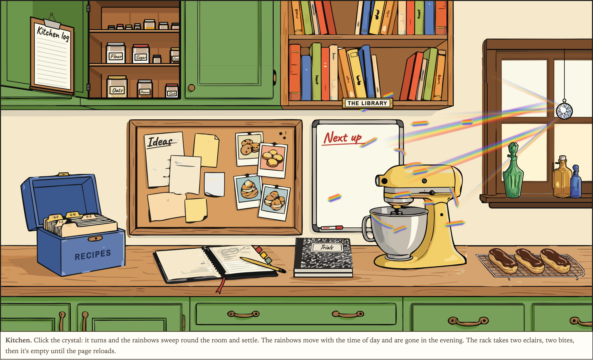
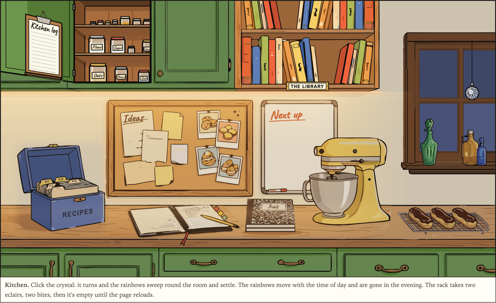
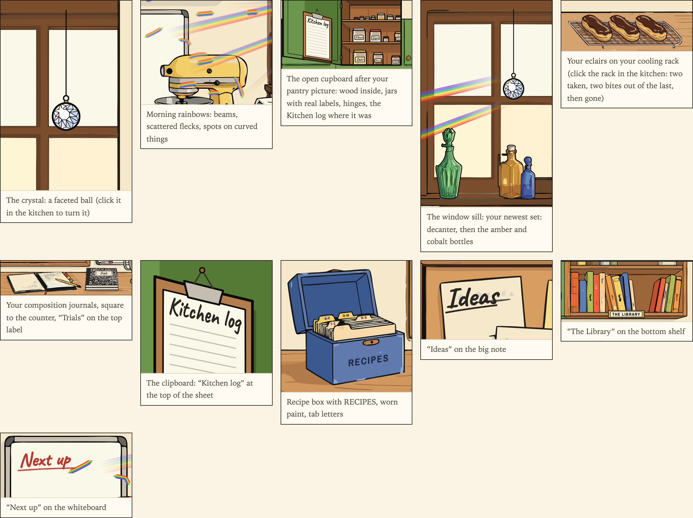
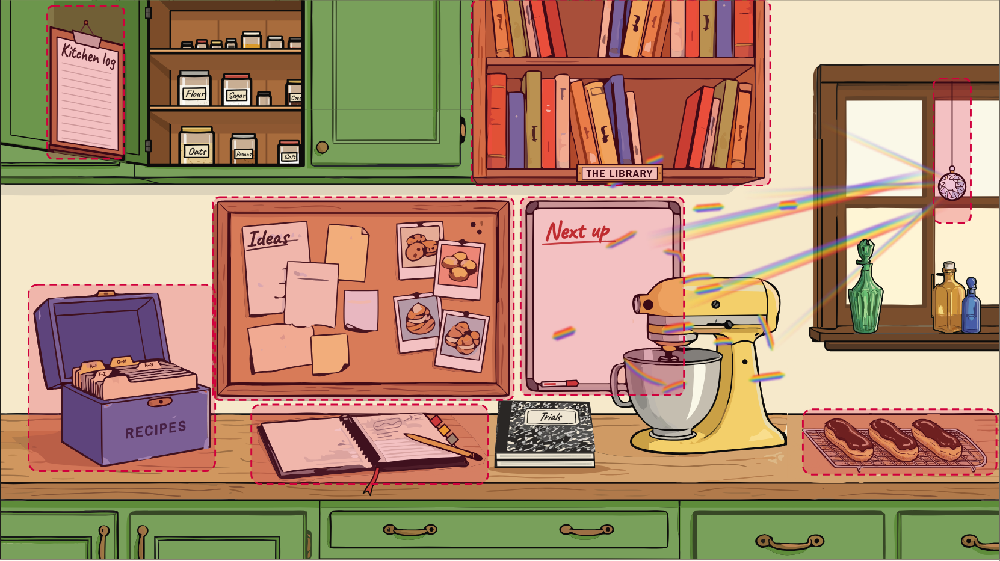

# Design reference: what is final

Written 2026-11-21. **This is the one source of truth for how things look and behave.** If a file, an old plate, a handoff or a memory says something different, this page wins. If the build doesn't match the pictures here, the build is wrong.

History (every version, every option Ari turned down) is in the archives listed at the bottom. Don't read them to decide anything; read them only to answer "why".

## What is final, per surface

| Surface | Final version | Picture | Source |
|---|---|---|---|
| **Kitchen, wide screens** | Plate XII v17, signed off 2026-11-20 | below | `design/plate-xii/traced/kitchen.svg`, built by `node traced/clean.cjs` (in `design/plate-xii/`). Page: https://claude.ai/artifact/JpRfR1F4DZCy9ctDCezeZj |
| **Open views** (recipe box, notebook, ideas, whiteboard, sign in, account, front page, not found) | Plate XI v2, signed off 2026-11-17, carried as drawn | Plate XI page: https://claude.ai/artifact/8eaxCBnwujNi1zg945oDBL | `design/plate-xi/sections/` |
| **Library view** (`/library`) | Phone Plate v5: one page, cookbook spines on top, reference cards below | [lib_main.png](../../design/phone/shots/v5/lib_main.png) | `design/phone/sections/06-library.html` |
| **Phone kitchen** | Phone Plate v5, signed off 2026-11-21 | [pk_day.png](../../design/phone/shots/v5/pk_day.png), [pk_eve.png](../../design/phone/shots/v5/pk_eve.png) | `design/phone/`. Page: https://claude.ai/artifact/8tvBLbfxEsEL48AzuMNeGy |
| **Mark** | Eclair G | Mark Plate: https://claude.ai/artifact/5baLfL52D5X1pNYCdNgS6F | `design/brand/base/mark.js` |
| **Colours, fonts** | Brand Sheet v4 | https://claude.ai/artifact/L3p52UdPaAsUBAa77J3gmi | `design/brand/` |

Where Plate XI or the phone plate shows the **kitchen itself**, Plate XII v17 replaces it. The phone plate is the guide for **layout** on a phone; for how any shared object **looks** (crystal, rainbows, bottles, journals, eclairs), the v17 kitchen wins. Plate XI's fridge, "Recently" list, floor and drawer-stack recipe log are gone.

## The kitchen (Plate XII v17)

Day (morning):



Evening:



Close-ups, with Ari's captions:



Buttons (red boxes = where you can point and click):



### Each object: what it is and what it does

Hit areas are in the SVG's own units (`viewBox="6 -39 856 479"`). They come from `design/plate-xii/sections/005-traced.html`; copy them from there, never from older files.

| Object | Looks like | Pointing at it | Clicking it | Hit area (x, y, w, h) |
|---|---|---|---|---|
| Recipe box | Blue 3 tin box, lid open, tabs A–F, G–M, N–S, T–Z, RECIPES on the front | amber glow from behind | opens the recipe box, `/box/<recipe>` | 30, 205, 160, 160 |
| Open notebook | spiral notebook open on the counter, coloured tabs, pencil, red ribbon | amber glow | opens the Trials notebook, `/notebook/...` (home cooks and guests get the read-only sample) | 221, 308, 203, 68 |
| Cork board | "Ideas" note, sticky notes, four pastry photos | amber glow | opens the idea board, `/ideas` (sample for home cooks) | 188, 130, 258, 174 |
| Whiteboard | "Next up" in red marker, marker on the tray | amber glow | opens the whiteboard, `/whiteboard` | 452, 130, 140, 170 |
| Library shelf | two rows of books (some blue spines), "THE LIBRARY" plaque | amber glow on the whole shelf | opens the Library, `/library` | 410, -39, 256, 159 |
| Clipboard | "Kitchen log" sheet on the inside of the open cupboard door | amber glow | opens the recipe log, `/log` | 46, -34, 66, 131 |
| Eclair rack | three chocolate eclairs on a wire rack, under the window | amber glow | each click: one taken, two taken, a bite, another bite, gone. A reload puts them back. Nothing is saved | 694, 312, 166, 56 |
| Crystal | faceted ball on a thread in the window | (no glow) | turns for 3 s; the rainbows swing round and settle. With reduced motion it turns without the swing | 806, 28, 32, 124 |
| Rainbows | soft beams and small flecks from the crystal | not clickable | follow the device clock: morning, midday and afternoon positions; **none in the evening** | none |
| Evening | window glass goes dusk blue, room dims, warm 2700K light under the wall cupboards | | starts from the device clock | none |
| Open pantry cupboard | wood inside, labelled jars: Flour, Sugar, Cocoa, Oats, Pecans, Salt | not clickable | none | none |
| "Trials" journals | stack of composition books, "Trials" on the top label | not clickable (open question below) | none | none |
| Mixer, bottles | buttercup stand mixer; sill bottles: green decanter, amber, cobalt | not clickable | none | none |

### Rules that apply everywhere in the kitchen
- **Pointing = amber glow from behind the object, nothing else.** No rise, lift, press, scale or wobble. Keyboard focus shows the same glow.
- Every clickable object is a real button over the drawing, with a label a screen reader reads ("Open the recipe box").
- Every open view has its own web address; Back returns to `/kitchen` (decision 005).
- Colours are CSS variables on the kitchen: `--cab` cabinets (stem green `#5e8c3a`), `--wall` (`#F6E9CB`), `--blue` box and brand (Blue 3 `#3F5F9D`), `--trim` window frame (walnut `#7A4E2D`). Cooks may later recolour cabinets and wall; the box colour is fixed.
- The drawing is Ari's trace. New pieces must match its thick, wobbly dark outline and flat two-tone colour.

### Gone for good (if you see one of these, it came from an old file)
"Baking log" · flour bag and rolling pin · an eclair on a plate, or eclairs anywhere but the rack under the window · the four-crystal mobile · bottle trio B1, decanter pair B2 · fridge and "Recently" · box and mixer swapped · lifting or pressing objects on point.

### Leftovers in the v17 source (not part of the design)
These are still inside `traced/add.cjs` and `kitchen.svg` but never shown. They don't change the picture; they are just weight and confusion.
- Flour and rolling pin paths are still in the SVG, painted over by a wall patch (`data-obj="flour"`, `"pin"`, `data-var="tidy-1"`).
- One-value switches `sill-3` and `tidy-1`; the page's `press` class has no style at all.
- `add.cjs` still defines the losing bottles (`BOTTLES`) and crystals (`CRYSTALS`, kept for the Later list).

### Open questions for Ari
1. Should the "Trials" journals open the notebook too? (Today only the open notebook does.)
2. The whiteboard's hit area overlaps the mixer's head a little, so pointing at the mixer head lights the whiteboard. Fine, or trim it?

## How the kitchen is built (for the test piece and the build)
```bash
cd design/plate-xii && node traced/clean.cjs      # writes traced/kitchen.svg (deterministic, ~2 MB)
node build.cjs                                     # the plate page, dist/index.html, to check by eye
```
The switchable parts of `kitchen.svg` are `<g data-var>` groups: `ecl-0` to `ecl-5` (rack states) and `sun-am`, `sun-noon`, `sun-pm`, `sun-eve`. Glow halos are `g[data-halo~="<object>"]`, shown with class `lit`. Object groups are `g[data-obj="<object>"]`. The page script in `sections/005-traced.html` is the working example of all of it.

## Archives (history, don't build from these)
- Every handoff prompt up to 2026-11-21: `.cursor/handoffs/archive/NEXT-2026-11-21-plates.md`
- The plate-by-plate plan (Plates X to XII, every version): `docs/design/archive/PLAN-2026-11-21-plates.md`
- The test piece first built by mistake on the v10 kitchen: local branch `archive/issue-180-v10-attempt`
- Every kitchen picture in order: https://claude.ai/artifact/E4xdK2o9H9iYMPpM8M7Juw
