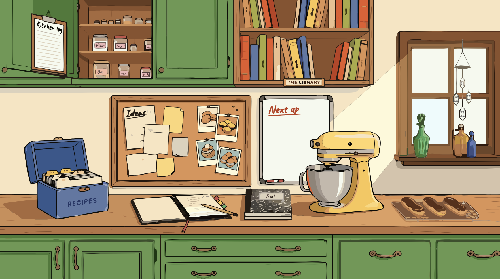

# Design reference: what is final

Written 2026-11-21. **This is the one source of truth for how things look and behave.** If a file, an old plate, a handoff or a memory says something different, this page wins. If the build doesn't match the pictures here, the build is wrong.

History (every version, every option Ari turned down) is in the archives listed at the bottom. Don't read them to decide anything; read them only to answer "why".

## What is final, per surface

| Surface | Final version | Picture | Source |
|---|---|---|---|
| **Kitchen drawing, wide screens** | **Wave 1 trace**, adopted 2026-11-21 (replaces the v17 drawing; prep script not written yet) | [source.png](../../design/kitchen-w1/source.png) | `design/kitchen-w1/source.svg` (Ari's Figma export with named layers; never edit by hand) |
| **Kitchen behaviour** | Plate XII v17, signed off 2026-11-20: what each object does is unchanged | below | `design/plate-xii/sections/005-traced.html`. Page: https://claude.ai/artifact/JpRfR1F4DZCy9ctDCezeZj |
| **Open views** (recipe box, notebook, ideas, whiteboard, sign in, account, front page, not found) | Plate XI v2, signed off 2026-11-17, carried as drawn | Plate XI page: https://claude.ai/artifact/8eaxCBnwujNi1zg945oDBL | `design/plate-xi/sections/` |
| **Library view** (`/library`) | Phone Plate v5: one page, cookbook spines on top, reference cards below | [lib_main.png](../../design/phone/shots/v5/lib_main.png) | `design/phone/sections/06-library.html` |
| **Phone kitchen** | Phone Plate v5, signed off 2026-11-21 | [pk_day.png](../../design/phone/shots/v5/pk_day.png), [pk_eve.png](../../design/phone/shots/v5/pk_eve.png) | `design/phone/`. Page: https://claude.ai/artifact/8tvBLbfxEsEL48AzuMNeGy |
| **Mark** | Eclair G | Mark Plate: https://claude.ai/artifact/5baLfL52D5X1pNYCdNgS6F | `design/brand/base/mark.js` |
| **Colours, fonts** | Brand Sheet v4 | https://claude.ai/artifact/L3p52UdPaAsUBAa77J3gmi | `design/brand/` |

Where Plate XI or the phone plate shows the **kitchen itself**, the Wave 1 drawing replaces it. The phone plate is the guide for **layout** on a phone; for how any shared object **looks** (crystal, bottles, journals, eclairs), the Wave 1 drawing wins, and v17 wins for rainbows and evening until Wave 1 has its own. Plate XI's fridge, "Recently" list, floor and drawer-stack recipe log are gone.

## The kitchen drawing (Wave 1 trace)



Same room, objects and places as v17, redrawn by Ari in one style. `source.svg` is 868 × 485, about 500 KB, 1,284 paths, with no filters, images or transforms. Each object is a named layer: `box`, `notebook`, `journals` (with `Trial`), `ideas` (with `Ideas`), `whiteboard` (with `Next up`), `library` (with `THE LIBRARY`), `clipboard` (with `Kitchen log`), `cupboard`, `jar labels`, `RECIPES`, `mixer`, `crystal`, `rack`, `window`, `cabinets`, `counter`, `wall`. Eclair pieces are named `eclair 1`, `eclair 2` and `eclair 3`.

Changes from v17's look: one "Trial" composition book (not a "Trials" stack), no sunbeam (removed 2026-11-24, see below), a hanging crystal mobile (kept, Ari 2026-11-21), no rainbows drawn (code adds them).

**Ari is doing one more Figma pass (2026-11-21).** When the new export arrives, replace `source.svg` and `source.png`. Any prep step below that the export already handles drops out of `prep.cjs`.

**Not finished in Figma, so a prep script must do it** (`design/kitchen-w1/prep.cjs`, to write; output `kitchen.svg`). Check its output against `source.png` with a pixel diff; only the intended changes may differ:
1. Move the 25 "Wave 2 … fragments" groups and 36 loose paths into their object's layer by the name before " — " or " / " (for example `eclair 2 / path 5` goes to eclair 2, `window — residual` to window). The stacking order must not change the picture.
2. Cut the 5 outlines shared by two objects at the object edge, so each object's glow covers only that object: box+notebook+counter, box+counter, whiteboard+mixer, cupboard+library, window+wall.
3. Gather the 4 `window glass …` pieces into one `glass` group for evening.
4. Map the cabinet greens to `var(--cab)`, the wall to `var(--wall)`, the box blues to `var(--blue)` shades, the window frame to `var(--trim)`, with one colour table.
5. Patch the counter and rack behind each eclair so an eaten one leaves an empty rack. The shared "counter and object shadows" path is the one to cut.
6. (Dropped 2026-11-24: the sunbeam is removed from the drawing in Figma step 5.)
7. Group ids for code: `data-obj="<object>"` per object, as in v17. Hit areas come from each object group's bounding box, not from numbers typed by hand.

### Making the kitchen swappable (rules for any future redraw)
A new drawing drops in if: each object is its own named layer, using the names above; each object's outline is inside its own layer (no outline shared across objects); the wall and counter are complete behind objects; each eclair is its own layer; colours you may change are flat fills in their own layers; words are outlined in their own layers; the window glass is its own layer; the canvas stays about 868 × 485 with no images, blurs or filters; and it is exported from Figma with "Include id attribute" on. Then only `prep.cjs` changes, and the React code finds everything by name.

## Kitchen behaviour (from Plate XII v17)

The pictures below are the v17 drawing. Use them for **behaviour** (evening, what's clickable); for looks, the Wave 1 picture above wins.

Day (morning):


Evening:


Close-ups, with Ari's captions:


Buttons (red boxes = where you can point and click):


### Each object: what it is and what it does

The hit-area numbers below are **v17 coordinates only** (`viewBox="6 -39 856 479"`) and don't fit the Wave 1 drawing. For Wave 1, hit areas come from each object group's bounding box (prep step 7). The numbers stay here only to show roughly what each area covers.

| Object | Looks like | Pointing at it | Clicking it | Hit area (x, y, w, h) |
|---|---|---|---|---|
| Recipe box | Blue 3 tin box, lid open, tabs A–F, G–M, N–S, T–Z, RECIPES on the front | amber glow from behind | opens the recipe box, `/box/<recipe>` | 30, 205, 160, 160 |
| Open notebook | spiral notebook open on the counter, coloured tabs, pencil, red ribbon | amber glow | opens the Trials notebook, `/notebook/...` (home cooks and guests get the read-only sample) | 221, 308, 203, 68 |
| Cork board | "Ideas" note, sticky notes, four pastry photos | amber glow | opens the idea board, `/ideas` (sample for home cooks) | 188, 130, 258, 174 |
| Whiteboard | "Next up" in red marker, marker on the tray | amber glow | opens the whiteboard, `/whiteboard` | 452, 130, 140, 170 |
| Library shelf | two rows of books (some blue spines), "THE LIBRARY" plaque | amber glow on the whole shelf | opens the Library, `/library` | 410, -39, 256, 159 |
| Clipboard | "Kitchen log" sheet on the inside of the open cupboard door | amber glow | opens the recipe log, `/log` | 46, -34, 66, 131 |
| Eclair rack | three chocolate eclairs on a wire rack, under the window | amber glow | each click: one taken, two taken, a bite, another bite, gone. A reload puts them back. Nothing is saved | 694, 312, 166, 56 |
| Crystal mobile | Wave 1: four crystals hanging from one hook in the window (v17: one faceted ball) | (no glow) | the whole mobile sways and settles in about 3 s, each crystal spinning a little out of step; the rainbows swing with it. With reduced motion the crystals spin and nothing swings | v17: 806, 28, 32, 124 |
| Rainbows | Wave 1: drawn layers per time of day (`rainbows-*`); v17 code rainbows until drawn. No sunbeam | not clickable | cross-fade with the device clock: morning, midday, afternoon; **none in the evening** | none |
| Golden hour | drawn layers (`golden hour`): a warm see-through overlay, a band of low light from the top right of the frame cutting down-left across the wall and cork board, warm shade outside it, long shadows falling down-left; no beam from the window across the whiteboard (Ari, 2026-11-24) | | from 4 pm to 8 pm local time | none |
| Night (evening) | drawn layer `evening light`: the room in blue shade except one clean pool of warm light from under the cupboard and library down to the counter (no rings), with a bright line under the cabinets the same width as the pool; code turns the window glass pale night blue (Ari, 2026-11-24) | | from 8 pm local time | none |
| Open pantry cupboard | wood inside, labelled jars: Flour, Sugar, Cocoa, Oats, Pecans, Salt | not clickable | none | none |
| "Trial" journal | one composition book beside the notebook, "Trial" label (Wave 1; v17 had a "Trials" stack) | not clickable (open question below) | none | none |
| Mixer, bottles | buttercup stand mixer; sill bottles: green decanter, amber, cobalt | not clickable | none | none |

### Rules that apply everywhere in the kitchen
- **Pointing = amber glow from behind the object, nothing else.** No rise, lift, press, scale or wobble. Keyboard focus shows the same glow.
- Every clickable object is a real button over the drawing, with a label a screen reader reads ("Open the recipe box").
- Every open view has its own web address; Back returns to `/kitchen` (decision 005).
- Colours are CSS variables on the kitchen: `--cab` cabinets (stem green `#5e8c3a`), `--wall` (`#F6E9CB`), `--blue` box and brand (Blue 3 `#3F5F9D`), `--trim` window frame (walnut `#7A4E2D`). Cooks may later recolour cabinets and wall; the box colour is fixed.
- The drawing is Ari's trace. New pieces must match its thick, wobbly dark outline and flat two-tone colour.

### Gone for good (if you see one of these, it came from an old file)
"Baking log" · flour bag and rolling pin · an eclair on a plate, or eclairs anywhere but the rack under the window · bottle trio B1, decanter pair B2 · fridge and "Recently" · box and mixer swapped · lifting or pressing objects on point.

### Leftovers in the v17 source (not part of the design; moot once Wave 1 replaces it)
These are still inside `traced/add.cjs` and `kitchen.svg` but never shown. They don't change the picture; they are just weight and confusion.
- Flour and rolling pin paths are still in the SVG, painted over by a wall patch (`data-obj="flour"`, `"pin"`, `data-var="tidy-1"`).
- One-value switches `sill-3` and `tidy-1`; the page's `press` class has no style at all.
- `add.cjs` still defines the losing bottles (`BOTTLES`) and crystals (`CRYSTALS`, kept for the Later list).

### Open questions for Ari
1. Should the "Trials" journals open the notebook too? (Today only the open notebook does.)
2. The whiteboard's hit area overlaps the mixer's head a little, so pointing at the mixer head lights the whiteboard. Fine, or trim it? (With Wave 1 hit areas taken from shapes, the mixer can sit on top and win.)
### Answered 2026-11-21
- **Crystal mobile: keep it.** The Wave 1 mobile replaces v17's single crystal; the rainbows still come from it.
- **Clicking the mobile (2026-11-22): the whole mobile sways as one piece.** One button covers the whole mobile ("Turn the crystal mobile"). The `crystal` layer swings a little from its hook and settles within about 3 s. Each crystal (its own sublayer) does v17's spin, slightly out of step with the others, so it reads as a mobile, not a pendulum. Keep the swing small so it isn't busy. With reduced motion, the crystals spin and nothing swings.
- **Rainbows (2026-11-22): drawn by Ari as layers, one set per time of day**: `rainbows-am`, `rainbows-noon`, `rainbows-pm`, placed differently for each time of day. They are flat, see-through colour bands and a few flecks, with no blur, **on the wall only** (Ari confirmed 2026-11-22: nothing on objects), behind the objects. Code cross-fades them, hides them in the evening, and swings the whole set when the mobile turns. Until they're drawn, v17's code rainbows are the fallback.
- **Sunbeam: none (Ari, 2026-11-24).** Three time-of-day beams were mocked up, but so little wall shows between the objects that they barely differed, and a beam would really move much more through the day. The beam that was baked into the wall art is removed, and there are no `sunbeam-*` layers. The rainbows carry the time of day; they come from the sun on the crystal, so they don't need a beam beside them (v17 had none). This replaces the 2026-11-22 answer (one beam per time of day).
- **Rough labels (jars, "Trial"): Ari redraws them in Figma.**
- **Labels, 2026-11-22: all of them get clean lettering** in v17's italic style: the six jars (Flour, Sugar, Cocoa; Oats, Pecans, Salt), "Trial", "Kitchen log", "Ideas", "Next up", "RECIPES", "THE LIBRARY".
- **Golden hour (2026-11-22): starts at 4 pm local time** and runs until night (8 pm). 2026-11-24 (Ari, from her own pictures): not just one overlay. It keeps the long shadows and a band of light from the top of the frame across the wall and cork board, but not the beam from the window down across the whiteboard. Drawn in Figma step 7.
- **Night (2026-11-24): from 8 pm local time.** The light comes from under the cabinets (option N1 of the mocks). The blue shade is drawn in Figma with the pool cut out, so the pool keeps the room's own colours, warmed; the bright under-cabinet line stops where the pool does. Ari also wants a **"lights on" option at night**, for working late: the room back to near-day colours, slightly warm, window still dark night blue (mocked, not drawn yet).
- **Clipboard (2026-11-22): no nail and string;** it sits a little higher, inside the open door, so the door could close.
- The Figma work and its progress are tracked in `design/kitchen-w1/FIGMA-PLAN.md`.

## How the v17 kitchen was built (reference until Wave 1's `prep.cjs` exists)
```bash
cd design/plate-xii && node traced/clean.cjs      # writes traced/kitchen.svg (deterministic, ~2 MB)
node build.cjs                                     # the plate page, dist/index.html, to check by eye
```
The switchable parts of `kitchen.svg` are `<g data-var>` groups: `ecl-0` to `ecl-5` (rack states) and `sun-am`, `sun-noon`, `sun-pm`, `sun-eve`. Glow halos are `g[data-halo~="<object>"]`, shown with class `lit`. Object groups are `g[data-obj="<object>"]`. The page script in `sections/005-traced.html` is the working example of all of it.

## Archives (history, don't build from these)
- Every handoff prompt up to 2026-11-21: `.cursor/handoffs/archive/NEXT-2026-11-21-plates.md`
- The plate-by-plate plan (Plates X to XII, every version): `docs/design/archive/PLAN-2026-11-21-plates.md`
- The test piece first built by mistake on the v10 kitchen: local branch `archive/issue-180-v10-attempt`
- Every kitchen picture in order: https://claude.ai/artifact/E4xdK2o9H9iYMPpM8M7Juw
