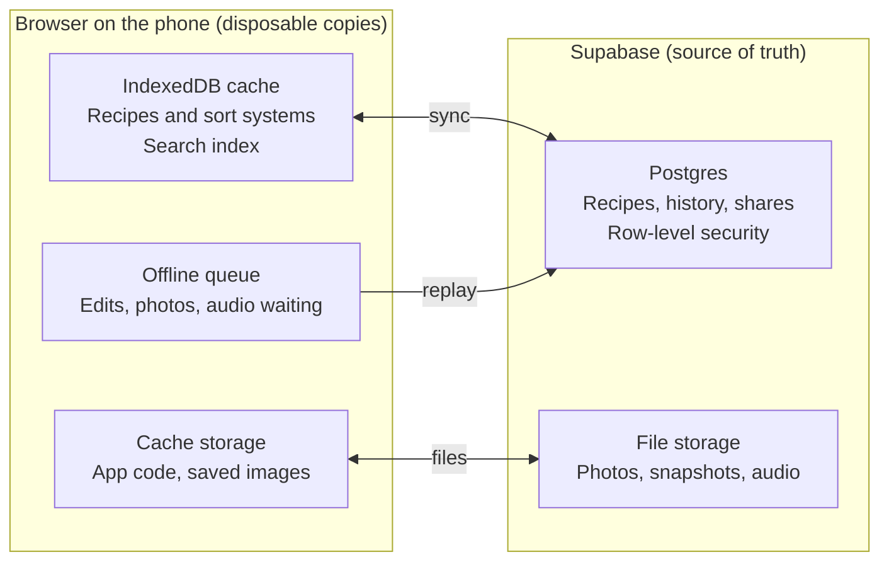
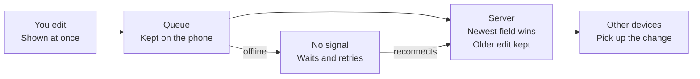

# Recipe Box: Technical specification (web app)

## 1. Platform decision: web app first

Build an installable, mobile-first web app first. It is faster to ship and cheaper to run than separate iOS and Android apps, and it fits sharing by link naturally. A store-listed app stays possible later without a rewrite.

|  | **Installable web app** | **Native iOS + Android** | **Web app wrapped for stores** |
| --- | --- | --- | --- |
| Codebases | One | Two (or one cross-platform framework) | One, plus a thin wrapper |
| Time to first usable build | Fastest | Slowest | Web time plus wrapper work |
| Releasing a fix | Deploy in minutes, no review | Store review each time | Web part instant; wrapper updates reviewed |
| Store fees | None | Apple annual fee, Google one-time fee | Both |
| Share links and previews | Native to the web | Needs deep-link setup | Needs both |
| Speech, camera, OCR | Browser APIs, uneven | Best | Browser APIs, or native plugins |
| Storage durability | Browser can evict | Reliable | Reliable with native storage |

**Web limits to plan for** (verify each on real phones before relying on it):

- **Storage can be evicted.** Browsers may clear site data for sites not used for a while, mainly in iOS Safari outside the home-screen app. Mitigation: recipes live on the server from first use (anonymous sign-in), the app asks the browser for persistent storage, and the on-device copy is a cache.
- **Speech recognition varies by browser** and may send audio to the browser vendor. Mitigation: browser speech first, server transcription as a fallback, and buttons that always work.
- **No web share target on iOS.** Android installed apps can receive shares; on iOS use paste-a-link or a Shortcut.
- **Browser OCR is slower and weaker on handwriting** than OS-level OCR. Mitigation: a cloud fallback.
- **Audio recording formats differ** between browsers. Mitigation: normalize on upload.
- **Install is manual on iOS** (Add to Home Screen). Mitigation: a short in-app guide.

**Keeping the store option open:** every device feature sits behind an interface (`SpeechProvider`, `OcrProvider`, `StorageProvider`, `ShareProvider`). If store presence matters later, the same build is wrapped in a native shell (for example Capacitor) and native providers are swapped in.

## 2. Architecture and technology choices

One TypeScript monorepo: a React web app talks to Supabase, the on-device store is a cache, and a few edge functions do what a browser shouldn’t.

```
Browser (installable web app, React + TypeScript)
  UI: SVG/CSS box renderer, gestures, motion      Offline: service worker + IndexedDB cache
  Domain package: parsers, units, scaling, voice state machine (pure functions)
  Providers: Speech, OCR, Storage, Share (swappable)
        |  HTTPS
        v
Cloudflare Pages: static app + edge-rendered share/feed pages (link previews)
        |
        v
Supabase: Auth (incl. anonymous) · Postgres + row-level security · Storage · Edge Functions
        |
        +--> URL import function (SSRF-safe) --> recipe websites
        +--> LLM fallback function (key stays server-side, rate-limited)
```

| Concern | Choice | Why | Cost |
| --- | --- | --- | --- |
| Language and UI | TypeScript, React, Vite | Most agent-fluent stack; fast builds and tests | Free |
| Data and routing | TanStack Query (persisted cache + offline mutation queue), TanStack Router | Offline-tolerant without a sync engine | Free |
| Offline | Service worker (Workbox via vite-plugin-pwa), Dexie over IndexedDB | Installable, saved recipes open without signal | Free |
| Box rendering | SVG + CSS 3D transforms, Motion, use-gesture | Enough for the front-on v1 and a later perspective Fan; no game engine needed | Free |
| Styling | CSS variables for design tokens, Tailwind | Tidy and Wild West are theme swaps | Free |
| Contracts | Zod schemas shared by app, data layer and functions | One source of truth for types | Free |
| Backend | Supabase | Auth, Postgres, storage, functions and row-level security in one | Free tier, then paid; free projects can pause when idle (verify) |
| Hosting | Cloudflare Pages + Functions | Free, preview URL per PR, edge pages for link previews | Free tier |
| OCR | Tesseract.js (WebAssembly) in the browser; cloud vision fallback | Free first, paid only when needed | Free / capped pay-per-use |
| Speech | Browser speech recognition and synthesis; server transcription fallback | Free first | Free / capped pay-per-use |
| LLM fallback | Anthropic API (a small, fast model) behind an edge function | Quality on messy pages and handwriting; only when deterministic parsing fails | Capped pay-per-use |
| Search | MiniSearch locally (autocomplete); Postgres full-text + trigram on the server | Works offline and at scale | Free |
| Component work | Storybook | Lets UI agents build in isolation | Free |
| Quality tooling | Vitest, Playwright, axe-core, Sentry, PostHog, Lighthouse CI, GitHub Actions | See sections 8 and 9 | Free tiers |

*Free-tier limits change often; verify them before committing.*

**Repository layout** (also the ownership map for parallel agents, Part 3):

```
apps/web            React app: features/box, card, import, share, voice ...
packages/contracts  Zod schemas and generated types
packages/domain     pure logic: parsing, fractions/units, scaling, filing, revisions, voice machine
packages/data       repositories, query hooks, offline queue
packages/ui         design tokens, shared components, Storybook
supabase/           migrations, RLS policies + tests, edge functions
e2e/                Playwright journeys, fixtures, accessibility checks
```

## 3. Data model

Postgres on the server is the source of truth; the browser caches the same shapes. IDs are UUIDv7, deletes are soft, and every table is protected by row-level security.

```ts
Recipe {
  id, ownerId, title, servings, prepMinutes, cookMinutes,
  look: 'auto' | 'tidy' | 'wild',            // per-recipe override
  sourceType: 'manual' | 'url' | 'scan' | 'voice' | 'paste',
  sourceUrl?, visibility: 'private' | 'link' | 'public',
  forkedFromRecipeId?, forkedFromRevisionId?,  // provenance of saved copies
  needsAttention, createdAt, updatedAt, deletedAt?
}
Ingredient { id, recipeId, position, raw, text, amount?, unit?, item?, note?, group? }
Step       { id, recipeId, position, text, group? }
Original   { id, recipeId, kind: 'image' | 'html' | 'text', path, pageIndex }
Tag, RecipeTag { recipeId, tagId }
SortSystem { id, ownerId, name, kind: 'alpha' | 'category' | 'custom', position, isDefault }
Divider    { id, sortSystemId, label, position, tagId? }   // alpha dividers derive from title
AudioNote  { id, recipeId, path, durationMs, transcript?, ingredientId?, stepId?, createdAt }
Revision   { id, recipeId, authorId, createdAt,
             source: 'manual' | 'voice' | 'import' | 'saved-from-share' | 'pulled-update', diffJson }
ShareLink  { id, recipeId, token, createdAt, revokedAt? }
Follow     { followerId, followeeId }
Report     { id, recipeId, reporterId, reason, status, createdAt }
Settings   { ownerId, key, value }              // look, motion, text size, default sort system
```

**Is `raw` the originally entered string? Yes.** For each ingredient line, `raw` is exactly what the person typed, said (the transcript), scanned (the OCR text) or imported, and it is never changed afterwards. `text` is the line currently shown. It starts equal to `raw` and is rewritten when the line is edited by hand or by a structured or voice edit (for example “1½ cups flour” becomes “2 cups flour”). The parsed fields (`amount`, `unit`, `item`) are derived from `text` and can be wrong, so the app displays `text`, and scaling uses the parsed fields only when the parse is confident; otherwise it flags the line for a look.

**Other rules**

- Revisions store diffs; restoring replays a diff in reverse. A saved copy’s first revision records where it came from (who shared it, when), which is what makes the provenance chain visible.
- Row-level security: owners read and write their own rows; other people can read only recipes marked link-only (by token) or public.
- Soft deletes keep undo and offline sync safe.

## 4. Import, parsing and autocomplete

Every import path produces the same thing: a draft recipe plus the original, shown on the Review screen. Deterministic and on-device steps run first; the LLM is a fallback.

**URL import**

1. The app sends the URL to an edge function. Browsers can’t fetch most recipe sites directly, and the function enforces SSRF protection, size and time limits, and rate limits, and keeps a snapshot of the page. Offline: the URL is queued.
2. Parse in this order: embedded structured recipe data (schema.org Recipe, JSON-LD or microdata), then readability-style extraction with heuristics, then the LLM fallback.
3. Normalize ingredients and steps; return the draft and snapshot. Save with the source link and attribution.

**Photo / scan**

1. Capture with the camera input (works everywhere) or live camera where supported; crop; multiple pages.
2. OCR runs in-browser in a Web Worker so the UI stays responsive.
3. A heuristic parser splits title, ingredients and steps. Low confidence or handwriting offers an optional cloud fallback; the person is told the image will be sent, and use is capped per day.
4. The Review screen shows the original beside the parsed card.

**Paste and share-target:** pasted text or links go through the same pipeline; the installed Android app can also receive shares.

**Ingredient parsing.** One shared function, `parseIngredient(text)`, in the domain package handles fractions (“1 1/2”, “1½”), ranges, mixed units, parentheticals and phrases like “a pinch”, and returns parsed fields plus a confidence. Import, manual entry, live preview and voice edits all use it.

**Autocomplete**

- **Ranking:** your own history (frequency and recency), then a bundled list of about 2,000 common ingredient names (trimmed from an open data set; no network calls), then units.
- **Engine:** MiniSearch in a worker, prefix plus fuzzy matching, results in well under 50 ms, fully offline.
- **Titles, tags, categories:** same engine over what is already in the box.
- **Accessibility:** the ARIA combobox pattern with an announced result count, full keyboard use, and suggestions that never auto-accept.
- **Mobile keyboard:** autocorrect and auto-capitalize off for ingredient fields, “next” on the return key, and the suggestion list sits above the on-screen keyboard.
- **Privacy:** suggestion data stays on the device; analytics never include recipe text.

**Cost control for cloud steps:** caching by content hash, per-user daily caps, a global monthly budget with an alert, and an in-app “this import was wrong” button that feeds the fixture suite.

## 5. Voice edit engine

The confirmation loop is a pure, deterministic state machine in the domain package, with no UI and no browser APIs, so it can be tested to 100%.

```
Idle → Listening → Parsing → Proposed → Confirming → Applied
                      |          |           |
                      v          v           v
                 Clarifying  Cancelled   Corrected → Proposed
```

- **Parsing:** a grammar covers the common edits first (change, set, add, remove, swap, scale, add step). Anything it can’t resolve goes to the LLM fallback, which must return a structured edit proposal validated against a schema, never free text.
- **Proposal:** a typed `EditProposal` (`op`, `target`, `before`, `after`). The read-back sentence is generated from the proposal itself, so what is spoken is exactly what will be applied.
- **Confirmation:** yes, no or a correction, by voice or by buttons. A timeout means cancel, never apply.
- **Applied:** one transaction updates the recipe and writes a Revision. Undo is always available.
- **Fractions and units:** one shared utility handles “one and a half”, 1½ and 1 1/2, conversions, and cooking-friendly rounding (never “0.333 cups”).
- **Trust mode** (skip confirmation for low-risk edits) comes later and is off by default.

**Speech providers (browser reality)**

- `SpeechProvider` wraps the browser’s speech recognition and synthesis. Support, accuracy and privacy differ by browser, and some send audio to the browser vendor, so the first use explains this.
- Fallback: record a short clip and transcribe on the server (capped use), selected automatically when the browser provider is missing or fails.
- Read-back uses browser speech synthesis (free, offline for most voices). Every spoken prompt is also shown on screen with Yes / No buttons.
- Audio notes use MediaRecorder; formats differ by browser, so uploads are normalized server-side. Optional transcripts are generated with the same provider and make notes searchable.
- Cook mode uses the Screen Wake Lock API where available, with a visible hint when it is not.

## 6. UI architecture

The box is drawn with ordinary web layers, so it stays accessible, fast and easy for agents to build and test.

- **Layers in Box View:** background, box back, lid card, box front, tabs, touch overlay. Each layer is its own element so depth cues (shadows, tab stagger, device-tilt parallax) are cheap. The later perspective Fan uses CSS 3D transforms on the same elements.
- **Pointer events, not touch events:** one gesture layer serves finger, mouse and pen. The double-click alternative for pulling a card out falls out of this, and every gesture also has a keyboard and button equivalent.
- **Renderer registry:** `CardRenderer` is chosen by `(look, sourceType)`. Tidy has one entry; Wild West has one per source type. Adding a card style never touches navigation code.
- **Design tokens:** colors, type, spacing, wood and paper textures live in one theme file; Tidy and Wild West are themes.
- **Accessibility layer:** the visual box is decoration over real buttons, lists and headings, so screen readers get a logical order. Simple List mode replaces the box visuals with a plain list and loses no function.
- **Motion:** every animation reads one `motionPreference`; Reduce Motion swaps animations for crossfades.
- **Mobile web details:** safe-area insets, dynamic viewport units so browser toolbars don’t break the layout, 48 px minimum targets, no hover-only controls, `touch-action` set so drags don’t scroll the page, and a layout that also works on desktop with a centered box.
- **Transitions** between lid card, tray and Card View use shared-element animation, with a plain fallback.

**Performance budgets** (checked in CI with Lighthouse CI): first load under 200 KB of JavaScript for the home screen, interactive within 2.5 s on a mid-range phone over fast 3G-class throttling, 60 fps tab-to-fan animation, tab tap response under 100 ms. OCR and speech code is loaded only when used.

## 7. Backend, offline and sharing

**Accounts and storage.** Supabase Auth with anonymous sign-in from first launch, so recipes are on the server from the first card and the person can upgrade to an email or social login later without losing anything. The browser stores a cache and asks for persistent storage.



The server holds the real copy; the browser keeps disposable ones that can be cleared without losing recipes.

**Offline behavior**

- Saved recipes, the box, search and autocomplete work with no signal (service worker plus IndexedDB cache).
- Edits made offline go into a mutation queue and replay in order when the connection returns. Conflicts resolve per field, last write wins, and a losing edit is kept as a revision so nothing is lost silently.
- Imports that need the network (URL, cloud OCR) are queued with a visible “waiting for connection” card.
- Each release carries a version; an “update available” prompt avoids stale cached code, and local schema upgrades are tested.



Queued edits replay in order; when two edits hit the same field, the newer wins and the older is kept as a revision.

**Sharing**

- **Share by link:** a `ShareLink` holds a random token. The link opens an edge-rendered page (with a link preview image and title) that shows the card without an account. Links can be revoked.
- **Save to my box:** an edge function copies the recipe into the saver’s box, sets `forkedFromRecipeId` and `forkedFromRevisionId`, and writes a Revision with source `saved-from-share`. The copy is independent.
- **Upstream updates:** when the original changes, the saver is offered a diff to review and apply; applying writes a `pulled-update` Revision.
- **Visibility:** private by default; link and public are explicit choices, and changing back to private revokes link access.

**Feeds (after sharing ships)**

- Public recipes feed Following, New and by-category lists, with Postgres full-text and trigram search. Pagination is cursor-based.
- Before launch: report button, `Report` queue with a simple admin view, rate limits on sharing and saving, takedown process, and a block-user option.
- Imported-from-web recipes are never published as copies; they appear as a link to the source with the author’s own notes.

**Security**

- Row-level security on every table, tested with automated policy tests (a user can’t read or write another user’s private rows).
- No service keys in the client; edge functions hold secrets, enforce request size limits, allow only http(s) URLs, and block private network addresses.
- Account deletion removes all server data; a full export (JSON plus media) is always available, so people are never locked in.

## 8. Testing strategy

Coverage is a gate, not the goal: every behavior a user depends on needs a test that fails if it breaks. Because agents write the code, the tests are also the spec, so acceptance tests are written before the feature.

| Layer | Tooling | Scope |
| --- | --- | --- |
| Unit | Vitest | Domain logic: ingredient parsing, fractions and units, scaling, sort systems, filing, revisions, provenance, voice state machine, normalizers |
| Component | Testing Library + Storybook | Card renderers, tabs, combobox, review screen, settings, using role and label queries |
| Integration | Vitest + MSW (mocked network) + local Supabase | Repositories, offline queue replay, import pipeline end to end, migrations |
| Database / security | Supabase local with SQL policy tests | Row-level security: private, link-only and public access, share tokens, revocation |
| Edge functions | Deno tests | URL import (including SSRF and oversize cases), LLM proxy caps, share and save |
| Fixtures | Saved corpus | 50+ saved recipe pages, 30+ photo/OCR samples (printed, typed, handwritten); every real-world import bug becomes a new fixture |
| E2E | Playwright: Chromium and WebKit with mobile device profiles | Critical journeys below, against a preview deploy |
| Accessibility | axe-core inside Playwright, keyboard-only runs, manual VoiceOver and TalkBack script per release | Every screen reachable and operable without sight or gestures |
| Visual | Playwright screenshots in both looks | Catches rendering regressions in the box |
| Performance | Lighthouse CI | Bundle and load budgets from section 6 |

**Coverage gates in CI**

- Domain package: 95% lines and branches; voice state machine and fraction/unit utilities: 100%.
- Overall: 85% lines. Coverage may not drop; failing tests, lint or type errors block merge.
- Optional later: mutation testing on the domain package, to check the tests actually bite.

**Critical e2e journeys**

1. First launch → add a recipe manually (using autocomplete) → it appears in Box View.
2. Tap a tab → fan opens → pick a card → card in the lid → open Card View → flip.
3. File a card by drag, by double-click pull-out, and by “File under…”.
4. Import from URL (mocked site) → review → save. Same for a photo fixture.
5. Voice edit: propose → read-back → “yes” applies; “no” cancels; a correction re-proposes; undo restores.
6. Record an audio note and play it back.
7. Switch Tidy and Wild West; switch divider sets.
8. Share a recipe by link → open in a fresh browser with no account → save to my box → history shows where it came from → original author edits → saver sees the update.
9. Revoked link and private recipe return “not available”.
10. Simple List mode, large text and keyboard-only complete journeys 1–3.
11. Offline: go offline, browse and edit; come back online and the queue replays; queued import resumes.
12. Install and update: the manifest is valid and an old cached version upgrades cleanly.

Before each release, a short manual smoke test runs on one real iPhone and one real Android phone.

## 9. CI/CD, monitoring and costs

**CI/CD and iterability**

- Trunk-based development: short-lived branches, one task per branch, a merge queue so every merge is tested against the latest main.
- Every PR runs lint, typecheck, unit, component, integration and policy tests, the coverage gate, and a Lighthouse budget, then gets a **preview URL** you can open on your phone. A Playwright smoke run hits the preview; the full e2e suite runs nightly and before release.
- Two environments (staging, production), each with its own Supabase project. Merge to main deploys to staging; promotion to production needs a green full run.
- Rollback is re-deploying the previous build (minutes). Database migrations are forward-only, tested against snapshots of every earlier schema, and written to be backward compatible for one release.
- Feature flags (PostHog) gate risky features such as the Fan view, trust mode and public feeds, with staged rollout percentages.
- Semantic versions and an auto-generated changelog.

**Monitoring**

- **Sentry:** JavaScript errors, performance traces and web vitals, with releases and source maps uploaded in CI; alerts on new issues and error-rate jumps.
- **PostHog (opt-in):** funnels (first recipe, import success, voice edit accepted, share and save), flag exposure. No recipe text, transcripts or audio in telemetry; events carry counts and outcomes only.
- **Backend:** edge function error rate and latency, database health, free uptime checks on the app and the import endpoint, and LLM and transcription spend tracked daily with alerts at budget thresholds.
- **Quality loop:** the in-app “this import was wrong” button (with consent) adds the page or image to a private queue that feeds the fixtures.

**Estimated running costs (early stage)**

| Item | Cost |
| --- | --- |
| Hosting and preview deploys | $0 on the free tier |
| Database, auth, storage, functions | $0 on the free tier; a paid plan is the likely first real cost (free projects can pause when idle) |
| Error tracking, analytics, flags | $0 on free tiers |
| CI | $0 on the free tier; small upgrade if queues slow agents down |
| OCR and speech | $0 in the browser; cloud fallbacks are capped pay-per-use |
| LLM fallback | Small and capped; only on parse failures |
| Domain name | A small yearly fee |
| App-store accounts | None for the web app |
| Agent usage to build it | Likely the largest cost; see Part 3 |
